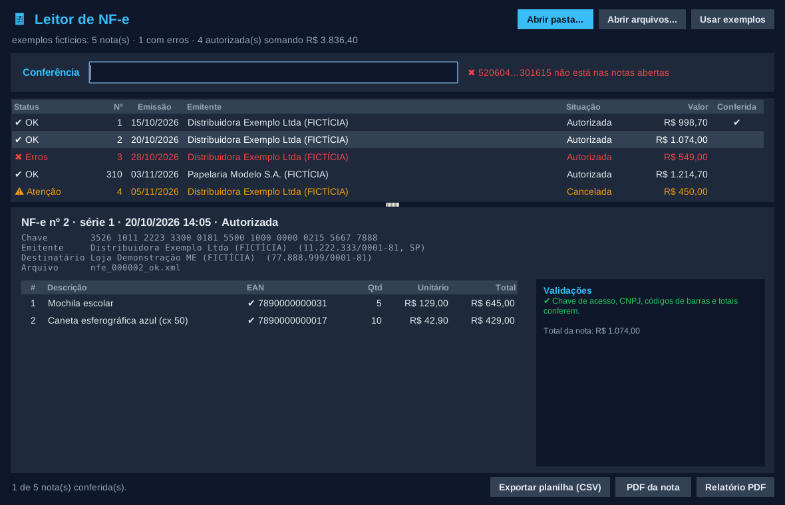
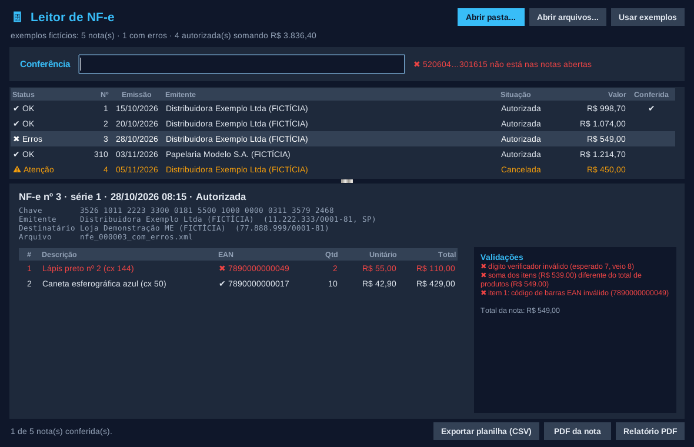
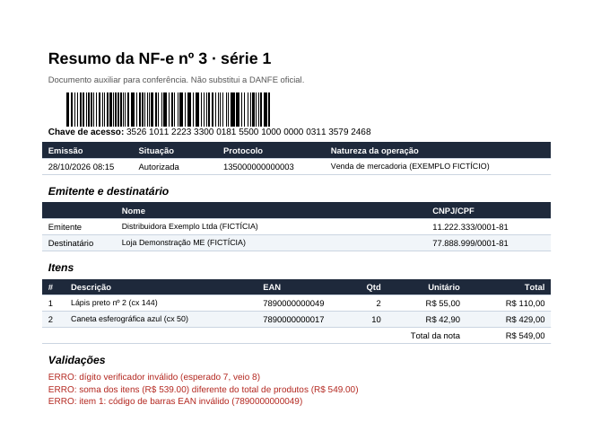

# Leitor de NF-e

Abre os arquivos XML de notas fiscais eletrônicas (NF-e e NFC-e), **valida** cada nota e permite **conferir com leitor de código de barras**: na entrada de mercadoria, basta ler o código da DANFE ou do produto. Exporta planilha e PDF.



| Nota com erros | PDF de conferência |
|---|---|
|  |  |

## Funcionalidades

- **Abre uma pasta inteira** de XMLs, ou arquivos escolhidos, e lista as notas com status, número, data, emitente, situação e valor.
- **Detalhes de cada nota**: chave de acesso, emitente e destinatário (CNPJ/CPF formatados), itens com EAN, quantidade e valores.
- **Validações**, sem precisar de internet:
  - **Chave de acesso**: 44 dígitos, dígito verificador (módulo 11), UF e mês válidos e coerência com a nota (número, série, modelo, CNPJ do emitente, UF e mês de emissão);
  - **CNPJ/CPF** do emitente e do destinatário;
  - **Código de barras dos produtos** (EAN-8, UPC-A, EAN-13 e GTIN-14). "SEM GTIN" é aceito;
  - **Totais**: soma dos itens contra o total da nota, e quantidade × valor unitário em cada item;
  - **Situação**: autorizada, cancelada, denegada ou sem protocolo.
- **Conferência com leitor de código de barras**: o leitor funciona como um teclado.
  - A **chave da DANFE** marca a nota como conferida.
  - O **EAN de um produto** mostra em qual nota ele está e com que quantidade.
  - Códigos com dígito errado (leitura falha) são apontados na hora.
- **Exportação**:
  - planilha **CSV** (uma linha por item, abre direto no Excel);
  - **PDF de conferência** de uma nota (com código de barras da chave);
  - **relatório PDF** de todas as notas, com os erros encontrados.
- **Exemplos fictícios** embutidos (botão **Usar exemplos**), incluindo uma nota com erros de propósito e uma cancelada.

> O PDF gerado é um resumo para conferência e **não substitui a DANFE oficial**.

## Segurança

XML vindo de terceiros pode trazer ataques, como a "bomba" de entidades (*billion laughs*) ou a leitura de arquivos do computador por entidades externas (XXE). Uma NF-e nunca usa `DOCTYPE`, então o leitor **recusa qualquer XML com `DOCTYPE`/`ENTITY`** antes de interpretá-lo, e também recusa arquivos acima de 5 MB. Os testes incluem um XML malicioso para garantir isso.

## Requisitos

- Python 3.9 ou mais novo, com Tkinter (já vem no instalador oficial do Windows e do macOS).
  - No Ubuntu/Debian, se faltar: `sudo apt install python3-tk`
- [reportlab](https://pypi.org/project/reportlab/), só para gerar os PDFs (`requirements.txt`). Ler, validar, conferir e exportar CSV funcionam sem ele.
- Qualquer leitor de código de barras USB que funcione como teclado (o padrão da maioria).

## Como usar

```bash
git clone https://github.com/thi-araujo/LerXML.git
cd LerXML
pip install -r requirements.txt
python leitor_nfe.py
```

No Linux/macOS, use `python3` e `pip3`.

1. Clique em **Abrir pasta...** e escolha a pasta com os XMLs (ou **Usar exemplos** para testar).
2. Clique no campo **Conferência** e leia os códigos de barras.
3. Exporte a planilha ou os PDFs.

## Estrutura do projeto

```
LerXML/
├── leitor_nfe.py      # interface gráfica (Tkinter)
├── nfe.py             # leitura segura do XML e validações (chave, CNPJ/CPF, EAN, totais)
├── exportar.py        # planilha CSV e PDFs
├── exemplos_nfe.py    # gera os XMLs fictícios de exemplo
├── exemplos/          # XMLs fictícios já gerados
├── tests/
│   └── test_nfe.py    # testes automatizados
└── docs/              # capturas de tela usadas neste README
```

O módulo `nfe.py` pode ser usado sozinho:

```python
import nfe

resultado = nfe.ler_pasta("caminho/dos/xmls")
for nota in resultado.notas:
    print(nota.numero, nota.emitente_nome, nota.valor_total, nota.problemas)
```

## Testes

```bash
python -m unittest discover -s tests -v
```

Os testes conferem os dígitos verificadores com o exemplo do Manual de Orientação do Contribuinte da NF-e e com CNPJ, CPF e EANs conhecidos. Também verificam a leitura das notas de exemplo, cada tipo de erro, a recusa de XML malicioso e a exportação.

## Dados de exemplo

As notas em `exemplos/` são **fictícias**: empresas, produtos e valores inventados. CNPJs, chaves e EANs foram montados com dígitos verificadores corretos só para passar nas validações. Os XMLs seguem a estrutura da NF-e 4.00, em ambiente de homologação (`tpAmb` 2) e sem assinatura digital.

## Histórico

Em 2023 este repositório reunia trechos de exemplo sobre ler um código de barras de um XML, validar XMLs com XSD, converter XML em PDF e enviar o PDF por e-mail. O arquivo não rodava: tinha blocos fora das funções, um `pip install` no meio do código e variáveis indefinidas. Em 2026 as ideias viraram um aplicativo completo para NF-e, com interface gráfica, validações, conferência por código de barras, exportação e testes. O envio por e-mail ficou no projeto [Automazicao_de_tarefas_envio_email](https://github.com/thi-araujo/Automazicao_de_tarefas_envio_email).

## Autor

**Thiago Gomes Araújo**: [GitHub](https://github.com/thi-araujo) · [Portfólio](https://thi-araujo.github.io)
